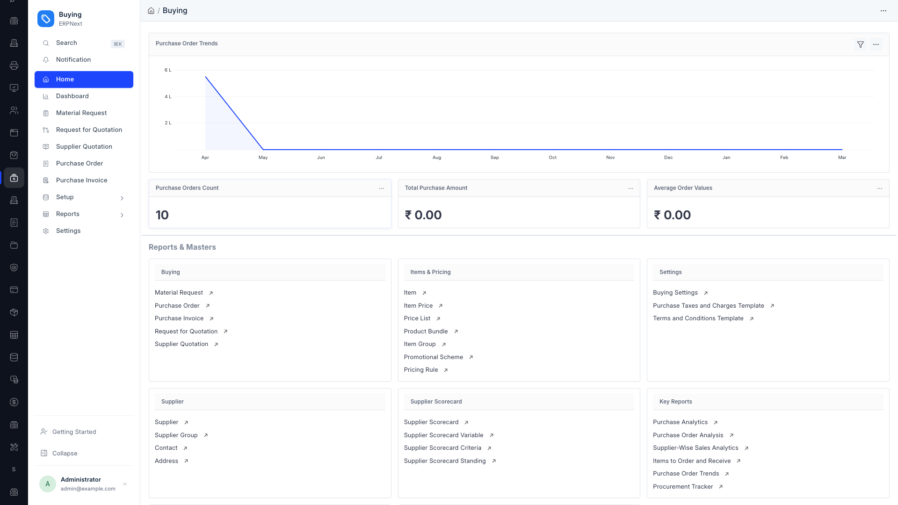
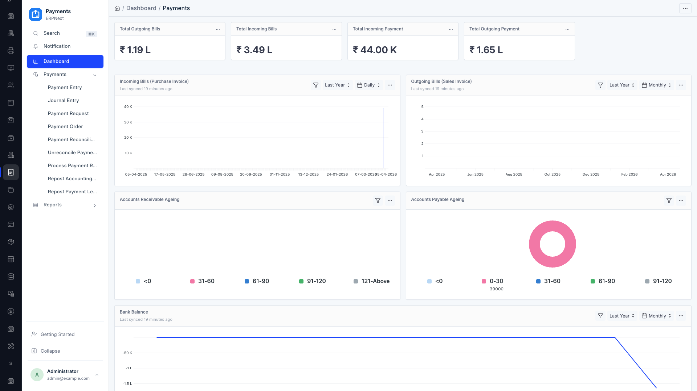
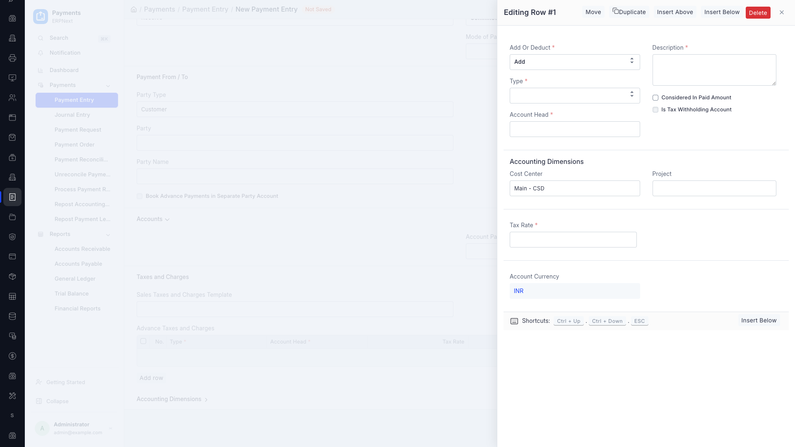
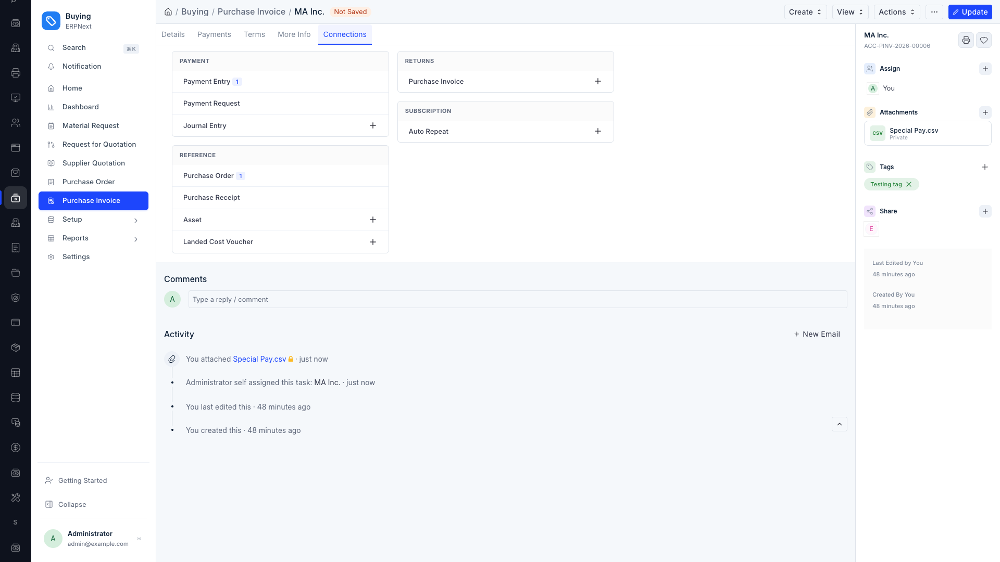
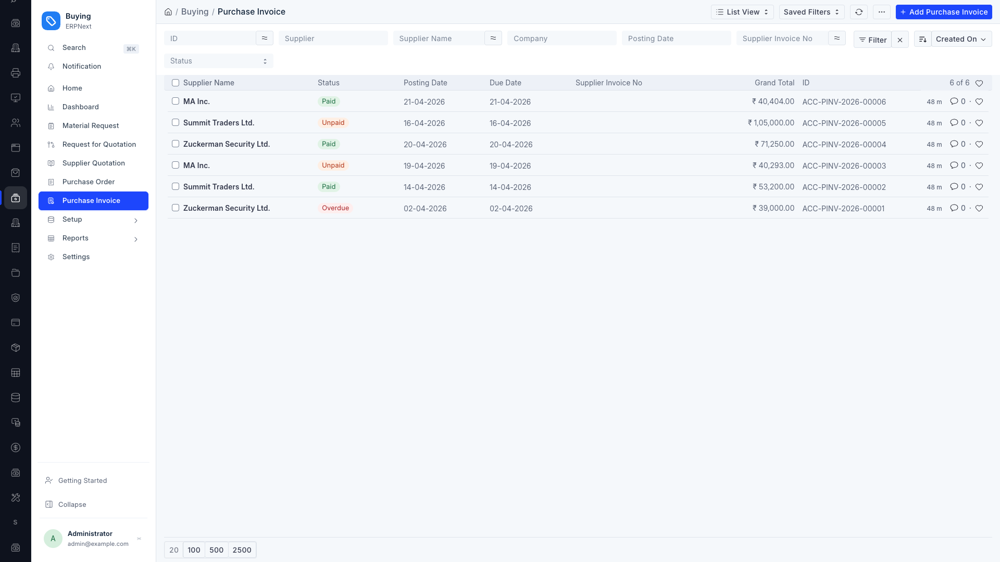
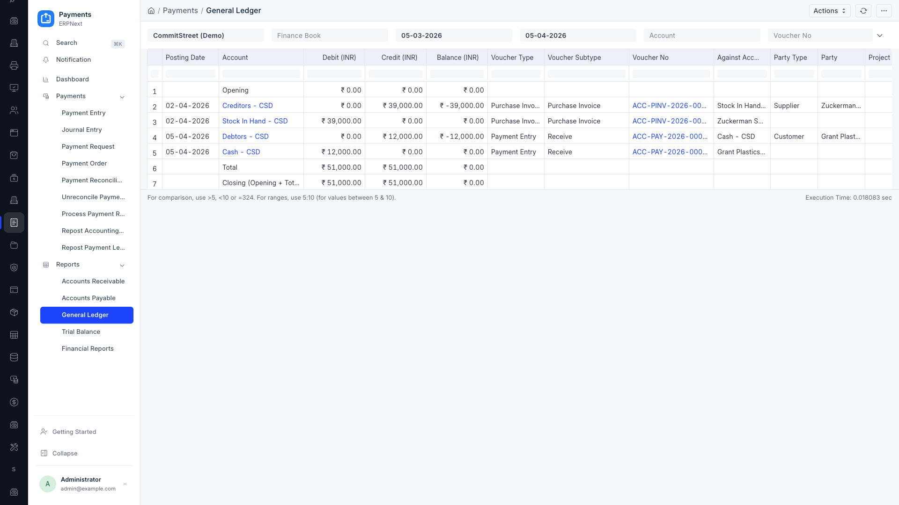
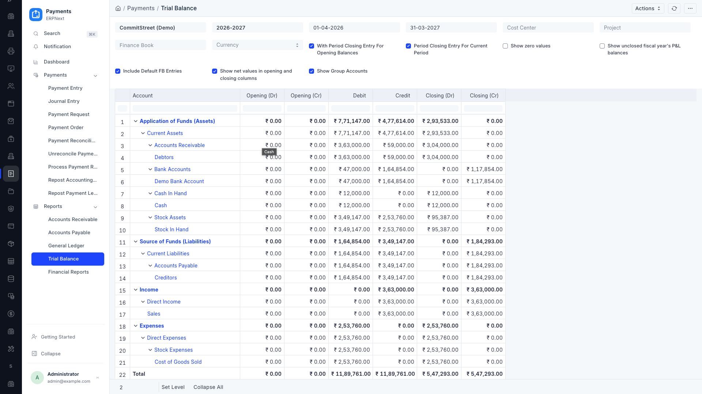
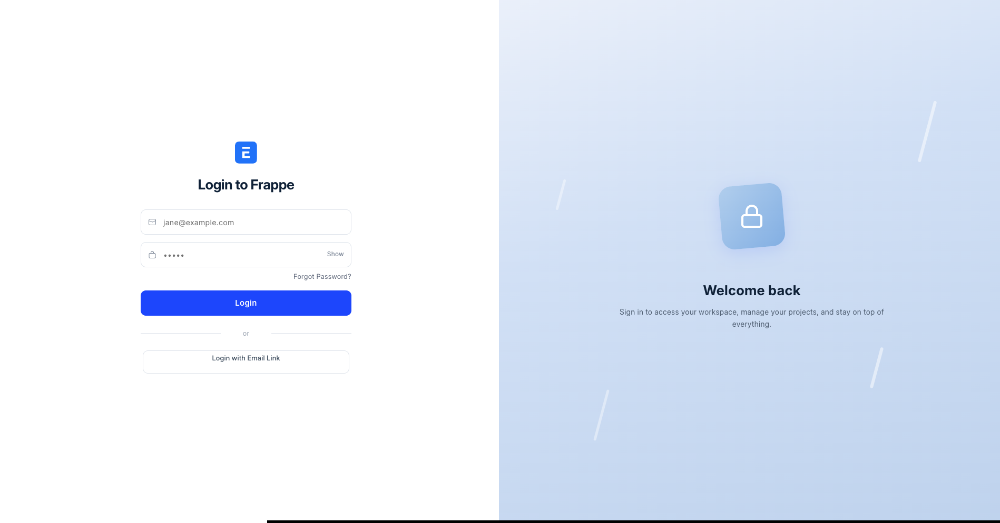

<p align="center">
  
</p>

<h1 align="center">ERPNext Theme</h1>

<p align="center">
  A modern, responsive workspace experience for <strong>Frappe Framework v16</strong> and ERPNext.
  Refined navigation, forms, dashboards, reports, and multilingual layouts.
</p>

<p align="center">
  <a href="#features">Features</a> ·
  <a href="#screenshots">Screenshots</a> ·
  <a href="#installation">Installation</a> ·
  <a href="#updating">Updating</a>
</p>

---

## Overview

**ERPNext Theme** is a customized version of the Frappe `saas_theme` app that refreshes the Desk interface without replacing core ERPNext business logic. It focuses on a cohesive, usable experience across workspaces, data entry, reports, and everyday navigation.

This repository maintains the `main` branch of the theme. The underlying Frappe app is still named `saas_theme`.

## Features

| Area | What the theme provides |
| --- | --- |
| **Workspace navigation** | A compact workspace rail, expandable sidebar, visual active states, and quick navigation |
| **Home & dashboards** | Refined workspace cards, KPI widgets, dashboard layouts, and responsive grids |
| **Forms & data entry** | Improved field spacing, tab styling, form sidebars, link-field controls, and child-table interactions |
| **Child-table editor** | A slide-in row editor with accessible actions and a scrollable panel |
| **List views** | Clearer rows, filters, action alignment, and document status presentation |
| **Reports** | Readability improvements for tabular and accounting reports, including tree-style views |
| **Appearance** | Light/dark styling, a refreshed login page, consistent controls, and theme refinements |
| **Languages & devices** | RTL layout refinements for languages such as Pashto and Dari, and responsive desktop/mobile layouts |

The precise appearance can vary by Frappe version, enabled apps, permissions, and site configuration.

## Screenshots

These are screenshots included in this repository, showing representative areas of the theme.

### Workspace home and navigation


### Dashboard experience


### Form and child-table editing
<table>
  <tr>
    <td width="50%"></td>
    <td width="50%"></td>
  </tr>
  <tr>
    <td align="center"><sub>Slide-in child-table editor</sub></td>
    <td align="center"><sub>Connections and form sidebar</sub></td>
  </tr>
</table>

### List view


### Accounting reports
<table>
  <tr>
    <td width="50%"></td>
    <td width="50%"></td>
  </tr>
  <tr>
    <td align="center"><sub>General Ledger</sub></td>
    <td align="center"><sub>Trial Balance</sub></td>
  </tr>
</table>

### Login page


## Requirements

- Frappe Framework **v16** (see `saas_theme/hooks.py` and `pyproject.toml` for version constraints).
- A working Frappe Bench installation and site.
- The application's Python requirement is declared in `pyproject.toml`.

## Installation

Install this repository, **not** the original upstream SaaS Theme repository, to get the customizations described above.

```bash
cd ~/frappe/frappe-bench

# Clone this theme under its Frappe app name.
bench get-app --branch main saas_theme https://github.com/zabih036/erpnext_theme.git

# Replace YOUR_SITE with the target site.
bench --site YOUR_SITE install-app saas_theme
bench build --app saas_theme
bench --site YOUR_SITE clear-cache
```

Restart your production Bench services using your normal deployment procedure. During local development, restart the development process if required. Avoid restarting production services without a maintenance plan.

## Updating

First check for local modifications and confirm that the checkout tracks this repository:

```bash
cd ~/frappe/frappe-bench/apps/saas_theme
git status
git remote -v
git branch --show-current
```

If the working tree is clean and the active branch is `main`:

```bash
git pull --ff-only origin main
cd ../..
bench build --app saas_theme
bench --site YOUR_SITE clear-cache
```

Restart the applicable Bench services to reload Python hooks or other server-side changes. If Git reports divergent history or uncommitted changes, inspect them before proceeding; do **not** discard your work to force an update.

## Project structure

| Path | Purpose |
| --- | --- |
| `saas_theme/hooks.py` | Frappe app metadata and CSS/JS asset registration |
| `saas_theme/public/css/` | Theme styling, responsive layouts, form/report refinements |
| `saas_theme/public/js/` | Desk interactions, navigation, dashboards, and UI behavior |
| `saas_theme/screenshots/` | Images used in this README |
| `THEME_MAINTENANCE.md` | Technical notes and change-safety guidance |

## Maintainer and licensing

Maintained in this repository by [@zabih036](https://github.com/zabih036).

This project builds on the original SaaS Theme codebase. The existing [MIT license and its original copyright notice](license.txt) remain in place. Retaining copyright attribution is separate from GitHub's commit-based contributor list.

---

<p align="center"><sub>ERPNext Theme · A refreshed interface for Frappe v16</sub></p>
